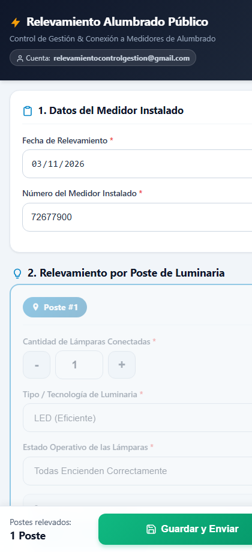
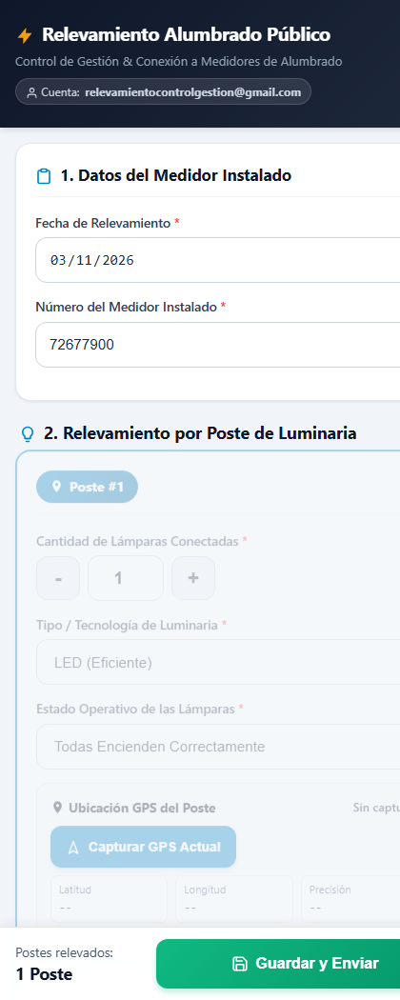
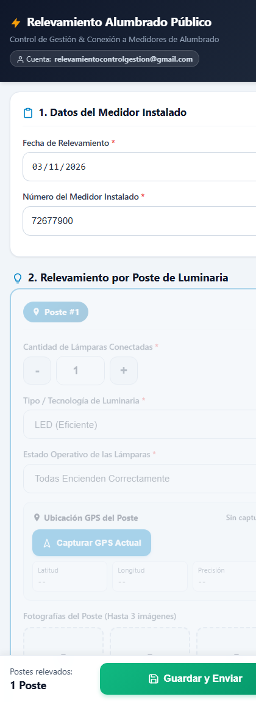
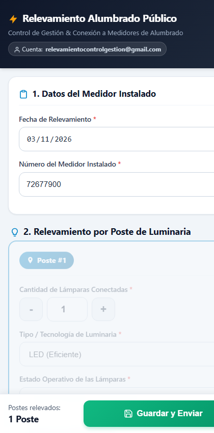

# 📘 Guía Operativa Ilustrada: Relevamiento Móvil de Alumbrado Público y Medidores

**Sistema**: Web App Móvil Progresiva (Google Apps Script / GitHub Pages)  
**Cuenta de Google de Destino**: `relevamientocontrolgestion@gmail.com`  
**Base de Datos**: Google Sheets (`Relevamiento_Alumbrado_Publico` - Pestaña `Relevamientos_Plano`, 16 columnas)  
**Almacenamiento Fotográfico**: Google Drive (`Fotos_Relevamiento_Alumbrado`)  
**Documento Word Oficial**: [`Guia_Paso_a_Paso_Relevamiento_Alumbrado_Publico.docx`](file:///D:/Proyectos/relevamiento-alumbrado-publico-medidores/docs/Guia_Paso_a_Paso_Relevamiento_Alumbrado_Publico.docx) o en Descargas (`%USERPROFILE%\Downloads`)

---

## 🎯 1. Propósito Operativo

Esta herramienta permite a las cuadrillas técnicas en la calle relevar de forma ágil y ordenada la vinculación física y eléctrica entre los medidores de alumbrado público y la totalidad de postes y luminarias conectados a cada uno.

### Optimizaciones Clave:
- **Carga Directa**: Solo se registra la **Fecha** y el **Número del Medidor Instalado** (ej. `72677900`).
- **Módulo Secuencial**: Posibilidad de agregar postes ilimitados (`Poste #1`, `Poste #2`, ... `Poste #N`) bajo el mismo medidor.
- **Geolocalización Satelital de 1 Clic**: Captura latitud, longitud y precisión en metros ($\pm X$ m).
- **Compresión Client-Side**: Fotos reducidas en el navegador a ~250 KB para ahorrar datos móviles.
- **Base de Datos Plana**: Cada poste genera una fila en Google Sheets repitiendo los datos del medidor para facilitar analítica en Power BI / Qlik Sense.

---

## 📲 2. Enlaces de Acceso en el Celular

- **Enlace Principal Recomendado (Sin login Google)**:  
  [https://protelem-epec.github.io/relevamiento-alumbrado-publico-medidores/](https://protelem-epec.github.io/relevamiento-alumbrado-publico-medidores/)
- **Enlace Alternativo (Google Apps Script Web App)**:  
  [https://script.google.com/macros/s/AKfycbxVGx8m5z6aRxQG7CJBp403RGS4e7jhpi__3OMvVQkZ3a8guJDd5CUlf7uI53R4N3qB/exec](https://script.google.com/macros/s/AKfycbxVGx8m5z6aRxQG7CJBp403RGS4e7jhpi__3OMvVQkZ3a8guJDd5CUlf7uI53R4N3qB/exec)

*(Consejo: en el navegador móvil, presione "Agregar a la pantalla principal" para usarlo con ícono directo como una app instalada).*

---

## 📸 3. Flujo Paso a Paso Ilustrado

### Paso 1: Apertura de la App y Carga del Medidor
Ingrese el número identificador del medidor de alumbrado público (ej. `72677900`). La fecha se autocompleta con el día en curso.

---

### Paso 2: Configuración del Poste #1 (Luminarias y Tecnología)
- Ajuste el número de lámparas físicas mediante los botones `[-]` y `[+]`.
- Seleccione la tecnología (`LED`, `Sodio Alta Presión SAP`, `Vapor de Mercurio`, `Mezcladora`, `Otro`).
- Indique el estado operativo (`Todas Encienden`, `Apagada / Fuera de Servicio`, `Enciende Parcialmente`, `Titilando`, `Tulipa Dañada`).

---

### Paso 3: Captura de Ubicación Satelital GPS
Al pie del poste, presione el botón azul `[📡 Capturar GPS Actual]`. En 1 a 2 segundos se obtendrán Latitud, Longitud y Precisión en metros (badge verde si es $\le 15$ m).

---

### Paso 4: Registro Fotográfico y Observaciones Técnicas
Toque los casilleros de fotos (hasta 3 imágenes por poste: general, artefacto y bajada). La app comprime cada foto automáticamente. Ingrese comentarios técnicos opcionales.

---

### Paso 5: Agregado Dinámico de Postes Múltiples
Presione `[➕ Agregar Relevamiento de Poste de Alumbrado]` para sumar el `Poste #2`, `#3`, etc., sin tener que reescribir el número de medidor. El contador inferior fijo se actualiza en tiempo real.

---

### Paso 6: Guardado, Envío y Confirmación Final
Presione el botón verde inferior `[💾 Guardar y Enviar]`. Al finalizar la transmisión, el modal indicará **¡Carga Exitosa!** con el total de postes asentados. Presione `[Iniciar Nuevo Relevamiento]` para limpiar el formulario y continuar con el siguiente medidor.

---

## 📁 4. Entregables Disponibles

- **Guía Completa en Word**: `docs/Guia_Paso_a_Paso_Relevamiento_Alumbrado_Publico.docx`
- **Plantilla de Correo Electrónico**: `docs/Mensaje_Email_Relevamiento_Alumbrado.txt`
- **Capturas de Pantalla**: `docs/img_guia/`
